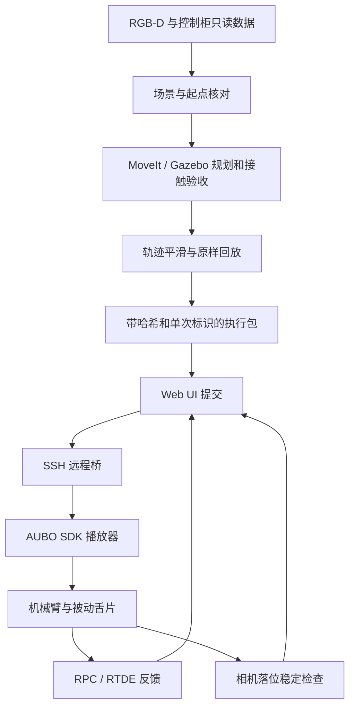

# AUBO S3 电池搬运项目 · 详细版

**公开仓库：** <https://github.com/CHANGJianshuo/meituan-aubo-s3-robotics>

**源码基准：** `meituan_challenge_ws`，主仓库提交 `00f60bf` 上的现场改动，加上输出目录中的最新 Web UI、播放器和调试脚本。这是独立公开快照，整理时没有修改原运行目录。

**现场日期：** 2026-10-14，America/Chicago。最新任务二结束记录为 2026-10-15 01:33:29 UTC。本文针对该次固定场景及软件配置。

## 阅读路线

| 想了解什么 | 对应章节 |
|---|---|
| 做成了什么 | 1：目标与结果 |
| 方案与原理 | 2–6：架构、复用、测量、仿真、平滑 |
| 实机和网页如何工作 | 7–9：执行、策略、Web UI、复位与异常 |
| 如何运行、接手代码 | 10–11：环境、命令、代码地图 |
| 证据和实际边界 | 12：验证、限制与后续工作 |

## 1. 目标、完成状态与测量口径

任务一把一块红色电池送到 T0；任务二按指定颜色顺序把三块电池送到 P1、P2、P3。两者使用 AUBO S3 六轴机械臂和 V1 被动舌片工具：从把手侧面插入、抬升承托，放置后卸载并抽出，没有电动夹爪闭合动作。

最终任务二顺序为 **红 → 黄 → 蓝（ABC）**。原示例中的 CAB 是另一套输入，不是本次现场顺序。舌片保持选定的参考朝向，绿块 D 留在起始区。

| 项目 | 已验证结果 | 口径 |
|---|---|---|
| 任务一阶段数 | 10/10 | 一次启动，中途无人工微调 |
| 任务一完整时间 | 175.872 → 90.439 s | 首次运动到末段检查完成，不含登录/RTDE 退出 |
| 任务一纯运动时间 | 142.392 → 55.605 s | 各段轨迹时间之和 |
| 最新任务二阶段数 | 30/30 | 30 次动作意图、30 次完成回执、一次总完成 |
| 最新任务二网页耗时 | 214.525 s | UI 保存的单调时钟 elapsed_ms |
| 最新任务二纯运动时间 | 114.009489 s | 各段保存轨迹末时刻之和 |
| 最后关节目标误差 | 0.003835° | 六轴实际末姿态与目标的最大绝对差 |
| 最后图像稳定区间 | 3.169734 s | 四个对象区域连续颜色轮廓核验 |
| 播放器返回 | 退出码 0 | 正常返回，无自动重试 |

任务二摘要位于 `docs/release/task2_latest_run.json`，记录原始证据路径和 SHA-256。原始现场日志、设备序列号和相机录制保留在本地；公开摘要是核对后提取的数据。运行时系统时钟有调整，因此计时采用保存的单调时钟，不用 UTC 起止时间相减。

关节误差回答“机械臂到没到目标姿态”，图像稳定回答“颜色轮廓是否持续匹配已核对的放置状态”。两者都不能直接给出电池相对于底图的毫米级绝对位置精度。

## 2. 系统结构与三条运行路径

项目同时保留软件架构验证、物理仿真和现场执行三条路径。区分它们，可以避免把某一层的成功扩大成整套系统已自动接通。

| 路径 | 主要链路 | 验证对象 |
|---|---|---|
| C++ Mock | Web → ROS ExecuteTask → C++ Task → C++ PickPlace → Mock 端口 | 状态机、Action、进度、取消和错误传递 |
| Gazebo | C++ PickPlace FSM → MoveIt → FollowJointTrajectory → gz_ros2_control → 接触物理 | 给定模型/场景中的承托、搬运、落位与退出 |
| 本次实机 | Web → 本机 Python 后端 → SSH → NUC → AUBO SDK 保存轨迹播放器 | 固定现场中已验证轨迹的真实执行与反馈 |



实机不是每一步重新检测抓取位姿并在线规划；全量 ROS Action 也没有被描述为已直接驱动真实硬件。这里先离线生成并验收轨迹，再由 SDK 播放，使轨迹来源、执行版本和失败位置可核对。

## 3. 任务一怎样复用于任务二

### 3.1 复用内容

任务一解决了单块电池的插入、承托、转运和退出。任务二复用了工具模型、控制柜匹配运动学、场景生成、接触仿真、轨迹导出、平滑和执行器；新增三组源物块/目标点、固定朝向检查、分段接续与网页全流程提交。

任务一现场补偿属于当时的几何关系。成功轨迹中的 J6 微转和基座 −Y 3 mm 修正已包含在路点里，回放时不能再次叠加。任务二沿用方法和已核对的安装关系，重新测量当前摆位，不能直接使用旧照片像素坐标。

### 3.2 每块电池的十段动作

| 序号 | 代码标识 | 动作及目的 |
|---:|---|---|
| 1 | `side_insert` | 接近把手，在插入前到达对准位置 |
| 2 | `hook_engage` | 水平插入舌片，进入把手下方 |
| 3 | `test_lift` | 小幅试提，检查承托 |
| 4 | `lift` | 垂直抬高，取得搬运间隙 |
| 5 | `transport` | 搬运到目标区域上方 |
| 6 | `pre_seat` | 到达预放置位置 |
| 7 | `seat_contact` | 下降到支撑表面 |
| 8 | `unload` | 卸载，让电池由底面支撑 |
| 9 | `side_withdraw` | 水平抽出舌片 |
| 10 | `retreat` | 撤离，避免继续接触电池 |

任务二按红 1–10、黄 11–20、蓝 21–30 段执行。平滑轨迹保留各段停点，起止速度、加速度为零。最早分段调试在关键位置观察；完整包将 30 段一次提交，由播放器推进阶段。

### 3.3 不要混淆三种颜色编号

| 电池 | 场景字母 | ROS/UI 枚举 | HSV 掩码下标 | 本次目标 |
|---|---|---:|---:|---|
| 红 | A | 1 | 0 | P1 |
| 黄 | B | 3 | 1 | P2 |
| 蓝 | C | 2 | 3 | P3 |
| 绿 | D | 4 | 2 | 起始区 |

ABC 对应 UI `ordered_colors=[1,3,2]`。不要直接写成 `[1,2,3]`，也不要把掩码下标当作 ROS 枚举。映射集中在 `hardware_tasks.py`。

## 4. 坐标、场景与视觉核对

### 4.1 数据来源与单位

ROS/轨迹计算使用米、弧度和秒；面向人的表格可换算为毫米或度。六轴固定顺序为 `shoulder_joint`、`upperArm_joint`、`foreArm_joint`、`wrist1_joint`、`wrist2_joint`、`wrist3_joint`。

场景需要相机内参、候选相机到基座变换、工具安装关系、支撑面、源电池/目标区域，以及控制柜读取的当前关节姿态。`fit_kinematics.py` 用控制柜只读 FK 查询匹配 URDF，这是数学模型对齐，不等于新做了物理绝对标定。

### 4.2 任务二处理流程

1. `capture_scene.py` 冻结 RGB-D，同时保存新鲜、静止的机器人状态；读取既有相机进程的结果，避免重复占用 USB。
2. `register_view.py` 将当前视角与参考配准，保留独立验证点的误差。
3. `estimate_scene.py` 用射线与已知高度平面求交、颜色区域和底图圆形估计对象/目标位置，迁移任务一已核对的对齐修正。
4. `build_scene.py` 写入初始关节角、障碍物、支撑面、固定工具朝向和 ABC 顺序。
5. `verify_scene_unchanged.py` 执行前再核对底图、物块和起点；`verify_placement.py` 与 UI 后端核对完成后的放置。

ROI 属于当时的相机视角。移动底图或相机后要重新采集与核对；工具遮挡电池时，缺少颜色像素不能直接解释为电池移动或成功抓取。

该方法依赖任务一现场参考、支撑面假设和人工确认的图像，尚不是对新场景即插即用的位姿估计。旧标定候选、历史测量与实际使用版本必须分别保存。

## 5. 规划、接触仿真与保存轨迹

环境为 Ubuntu 24.04、ROS 2 Jazzy、Gazebo Harmonic。`mtc_simulation` 提供机械臂、V1 工具、电池和底图模型，用 MoveIt 生成轨迹，经 FollowJointTrajectory 驱动 Gazebo 控制器。

仿真依靠碰撞和接触承托，不通过强制绑定电池到工具来制造成功。验收关注试提后支撑、搬运、最终区域/姿态/稳定时间及工具卸载退出。仿真使用已知场景状态，不能当作视觉系统已估出了真实位姿。

保存成功轨迹后，把**同一批关节命令原样回放**。导出工具保留命令及 SHA-256；打包器检查平滑输入、回放与导出一致，避免将另一次成功规划误当作实际执行轨迹。

`run_v1.py` 使用隔离的 ROS domain / Gazebo partition，核对本次进程与退出状态。`--pin-moveit-plugins` 是对所用 MoveIt 版本退出问题的显式选项。物理验收通过但进程退出失败，不能算完整通过。

Gazebo 的位置伺服、碰撞网格和接触参数仍是近似，不能替代工具材料强度、真实负载、力矩或现场碰撞验证。

## 6. 平滑与提速

核心在 `scripts/task1_real_scene/retime_successful_trajectory.py`，任务二直接复用。轨迹同时保存关节位置、速度和加速度；相邻采样间使用五次多项式，通过平滑时钟和路径运动量重新分配时间，保留关键点、内部停点和静止起止条件。

密集采样用于检查路径偏差；打包时进一步使用 **Bernstein 系数包络**检查完整插值区间的导数上界，避免离散点之间隐藏的速度或 jerk 峰值。相距不足 1 ms 的时刻会合并，减少过短区间放大数值误差。

| 任务二提速设计约束 | 设置 |
|---|---:|
| 一般关节速度 | 13°/s |
| J3 速度 | 11.5°/s |
| 加速度 | 25°/s² |
| jerk | 200°/s³ |
| 工具参考点路径偏离检查 | 不超过 0.1 mm |

这些是本次轨迹的工程约束，不是厂商认证的通用限值。若指定时长无法满足约束，生成器拒绝，不靠提高控制柜速度滑块达标。

任务二分段调试后得到约 228.019 s 的二倍速完整轨迹；后续通过路径及时间分配调整达到 114.009 s。最后几轮按现场要求保留原始起点、30 段路径和时间，只生成新执行标识、核验现场和选择跟踪策略。

“平滑”不表示段间不停顿。接触、卸载和退出需要检查，停点与稳定等待都保留，所以纯运动 114.009 s 的全过程会更长。

## 7. 实机执行与跟踪策略

### 7.1 执行包

`prepare_fullflow.py` 将经过回放验证的 ABC 30 段轨迹、匹配播放器及哈希写成一个执行包。包关联唯一 `plan_id`，固定关节顺序、单位、设备身份、TCP/负载配置快照、起点和限位。

播放器通过 AUBO SDK 上传关节路径缓冲区，获取 RPC 与 RTDE 反馈。RTDE 订阅实际和目标关节位置、速度、目标加速度及状态，现场配置为 100 Hz。仓库包含自编封装，不含 SDK 二进制。

`hardware/sdk_helpers/` 包含 `smoke.py`、`j6_45.py`、`telemetry.py`。播放器使用其中的连接与状态封装；`j6_45.py` 的旧点动命令不是本任务入口。

### 7.2 保留的检查

- 轨迹与播放器散列、执行标识、设备配置一致。
- 开始时无已有运动或排队命令，处于允许的控制和安全状态。
- 起点和每段末端最大关节差不超过 0.05°，静止速度阈值为 0.02°/s，并等待连续稳定。
- 检查关节限位、阶段轨迹范围、反馈有效性和新鲜度。
- 保留独占锁、单次执行台账、会话心跳及本会话停止通道。
- 不自动重发结果不确定的动作，不自动回原位。

### 7.3 跟踪策略的演变

跟踪误差是 RTDE 中实际关节位置与控制器目标位置之差。它不同于起终点相对于指定姿态的误差，也不同于物体放置误差。

| 播放器目录 | 六轴跟踪误差幅值策略 | 用途 |
|---|---|---|
| `guarded_05` | 全部 0.5° | 打包器默认基线 |
| `j4_06` | J4 0.6°，其余 0.5° | 中间现场版本 |
| `all_06` | 全部 0.6° | 后续准备版本 |
| `tracking_monitor` | 只记录，不因该误差幅值停止 | 最新现场成功版本 |

此前一轮在第 11 段记录到 J1 约 0.500505° 超过 0.5° 而停止，另一轮在蓝块接近时触发 J4 阈值。操作者逐步要求调整，最终选择取消这项软件幅值停止判定。代码绑定策略和请求记录，避免 UI 标签、执行包和播放器行为不一致。

最新版本 `tracking_guard_action=record_only`，不会因跟踪误差变大触发该项停止。**这不是取消所有阈值，也不是关闭控制柜保护。** 打包器默认仍为 0.5°；选择最新策略需要显式参数、匹配播放器和固定请求记录。

最新成功一轮的六轴最大记录跟踪误差约为 `[0.439742, 0.371416, 0.389015, 0.443010, 0.011185, 0.448310]°`。这是一次运行的观察结果，不是未来运行误差的保证。

## 8. Web UI 与单次执行

网页使用本地 HTML/CSS/JavaScript，Python 标准库提供 HTTP 服务，无 npm/CDN。服务只监听本机，检查 Host/Origin；HTTP API 和页面共用后端。

实机后端读取执行包，显示 ABC 顺序、当前段、关节状态、相机画面和跟踪策略。提交后，NUC 远程桥核对哈希、取得独占锁并登记尝试，网页根据真实反馈更新阶段。

HTTP 202 仅表示接收请求，不能解释成机械臂已完成。最终成功需要全部阶段回执、播放器结果、末姿态与停稳核对，以及至少 3 秒的落位图像证据。

停止请求针对本会话拥有的执行。远程桥失去监督心跳或 SSH 输入关闭时会发起停止处理；请求送达、返回码、独立停稳是不同层次的证据，不能合并成一个未经核验的“已停”。

同一包有单次台账，网页刷新不应重发动作，所以成功后不能反复点击同一个包开始下一轮。物块复位、关节回原始姿态并核验后，生成新标识和核对记录；若要求原轨迹，保留 q/v/a/t 即可，不必重新规划。

凭据只在进程内保存，经 SSH stdin 传递，不写入仓库、参数列表或邮件。服务退出后需要重新登录。完整任务由网页提交；登录连接和只读观察不等于发出运动。

## 9. 复位、异常与恢复

机械臂回初始姿态和电池回起始区是两项操作。`prepare_return_to_start.py` 可组合已验收接近路径及逆向回放，生成独立空载复位候选；还需场景碰撞及原样仿真检查，数学时间反演本身不足以证明可执行。

复位使用独立记录，不算在 30 段搬运内。不能在电池仍被承托时套用空载路径，也不能删除旧台账来制造“未执行”。

现场曾出现 RTDE 订阅收尾超时：动作已完成，进程却异常退出。恢复前要核对阶段回执、总完成记录、当前关节停稳和相机状态；确认后只接续未执行部分，缺少证据时不能自动重播。

`field_session.py` 保存分段完成前缀和恢复检查点；完整 Web UI 包保留单次语义。视觉核验中也遇到颜色掩码顺序和工具遮挡问题，后来统一任务二 HSV 规则和对象 ROI，旧失败记录仍留存。

## 10. 从电脑演示到实机部署

### 10.1 只体验网页

Python 3 即可，不需要 ROS、SDK 或设备：

```bash
git clone https://github.com/CHANGJianshuo/meituan-aubo-s3-robotics.git
cd meituan-aubo-s3-robotics
bash scripts/start_demo.sh --port 8877 --output-dir /tmp/mtc-web-demo-001
```

打开 `http://127.0.0.1:8877/`，输出目录必须不存在。此模式明确标记为演示，软件状态不能作为实机证据。

### 10.2 离线检查与测试

公开轨迹保留成功版本的全部 q/v/a/t，去除设备身份和部署路径等元数据，标记 `OFFLINE_REFERENCE_ONLY`。用标准库检查：

```bash
python3 scripts/validate_public_trajectories.py
```

安装数学、视觉及测试依赖后执行现场与 UI 回归：

```bash
python3 -m venv .venv
source .venv/bin/activate
pip install -r requirements-offline.txt
NO_PROXY='*' no_proxy='*' PYTHONPATH=src/mtc_cpp_mock_bringup \
  python3 -m pytest -q tests/test_task2_*.py \
  src/mtc_cpp_mock_bringup/mtc_webui --import-mode=importlib
```

播放器使用同名模块，应在各自目录单独测试：

```bash
cd hardware/players/tracking_monitor
python3 -m unittest -q test_runner
```

以上使用假控制器或离线数据，不发出实机动作。完整记录见 `docs/release/VALIDATION.md`。

### 10.3 C++ Mock 与 ROS Action

Ubuntu 24.04 / ROS 2 Jazzy，按各包声明准备 `rclcpp`、`rclcpp_action`、`rclpy`、消息包、ament/gtest 等依赖。ROS 工具链使用系统 Python，与硬件 Python 3.10 环境分开。

```bash
source /opt/ros/jazzy/setup.bash
MAKEFLAGS='-j2' colcon build --packages-up-to mtc_cpp_mock_bringup \
  --executor sequential --cmake-args -DCMAKE_BUILD_TYPE=RelWithDebInfo -DBUILD_TESTING=ON
source install/setup.bash
export ROS_DOMAIN_ID=161
export ROS_AUTOMATIC_DISCOVERY_RANGE=LOCALHOST
ros2 run mtc_cpp_mock_bringup mock_stack \
  --namespace /mtc_cpp_mock --output-dir /tmp/mtc-cpp-mock-001 --port 8877
```

这是 C++ Action 联调入口，区别于纯网页演示，也区别于真实机械臂执行。接口和停止语义见 `src/mtc_cpp_mock_bringup/README.md`。

### 10.4 Gazebo

需要 Gazebo Harmonic、`ros-jazzy-ros-gz`、`ros-jazzy-gz-ros2-control`、MoveIt、nlohmann-json 及 AUBO description/MoveIt 配置 overlay。外部驱动准备见 `docs/setup/AUBO_ROS2_DRIVER_JAZZY.md`。

```bash
export MTC_DRIVER_SETUP=/path/to/aubo_s3_mock_ws/install_no_symlink/setup.bash
bash src/mtc_simulation/scripts/build_v1.sh
source install/v1_sim/setup.bash
ros2 run mtc_simulation run_v1.py \
  --task sequence --order ABC --pin-moveit-plugins \
  --timeout 2400 --output outputs/v1_sequence_001
```

该命令运行通用仿真。复现现场几何需提供 `--scenario`；原样回放通过 `--replay-commands` 指定命令。公开轨迹示例不是当前现场的可执行部署包。

### 10.5 实机准备与启动

现场 NUC 为 Python 3.10、`pyaubo-sdk==0.24.1`，控制柜记录版本为 `0.25.6-alpha.1+c24e317c`。这是实测版本记录，换环境后需重新核实兼容性。

准备顺序：本站点采集 → 场景 → 仿真和回放 → 新执行包 → 部署/哈希核验 → 只读检查起点和场景 → 网页提交。不能把公开示例直接改成“允许执行”来跳过这些环节。

复制 `hardware/hardware_config.example.json` 为被 Git 忽略的 `hardware_config.local.json`，填写 NUC、包路径、散列及核验文件。设备身份、限位和配置快照来自本站点读取，不能抄文档数值替代。

准备完成后的登录入口：

```bash
python3 hardware/login_webui.py \
  --config hardware_config.local.json \
  --output-dir outputs/webui-session-001 --port 8767
```

NUC 用 `MTC_SDK_HELPERS` 指向封装目录，`MTC_HARDWARE_PYTHON` 指定 SDK Python；SSH 远端环境也要能找到封装。字段说明见 `hardware/README.md`。

## 11. 代码地图与阅读路线

| 目的 | 入口 |
|---|---|
| 任务与抓放 FSM | `src/mtc_task_cpp/`、`src/mtc_manipulation_cpp/` |
| Action 与父子 Goal | `src/mtc_interfaces/`、`src/mtc_ros2_action_cpp/` |
| 运动和异常语义 | `src/mtc_motion_execution_cpp/`、`src/mtc_trajectory_execution_cpp/` |
| 仿真接触与验收 | `src/mtc_simulation/src/v1_task.cpp`、该包 `scripts/analyze_v1.py` |
| 测量与运动学 | `scripts/task1_real_scene/`、`scripts/task2_real_scene/estimate_scene.py` |
| 平滑算法 | `scripts/task1_real_scene/retime_successful_trajectory.py` |
| 完整包 | `scripts/task2_real_scene/prepare_fullflow.py` |
| 实机执行 | `hardware/players/tracking_monitor/run_hardware.py`、`hardware/remote_bridge.py` |
| UI 状态与视觉 | `src/mtc_cpp_mock_bringup/mtc_webui/hardware_backend.py` |
| 颜色与阶段 | 同目录 `hardware_tasks.py` |
| 各轮调试源码 | `archive/field_sources/` |

原工作区和 Web UI overlay 有少量同名不同版本文件。根 `src/` 使用最新 Web UI 配套版本，旧差异保存在 `archive/workspace_before_webui/`；`COLCON_IGNORE` 防止旧包重复构建。

`docs/release/source_manifest.json` 保存逐文件来源、原始与公开散列及整理变更。站点地址使用示例占位，主目录路径已泛化；可配置 SSH、运行入口、文档和公开轨迹检查器是发布整理补充的内容。

## 12. 验证证据、限制与后续工作

最新任务二摘要核对了 22,099 条 RTDE、3,770 条运动 RPC、30 次动作/完成、正常退出与末尾图像稳定。发布时另对整理后的代码做离线测试、轨迹检查和 C++ 构建，见 `docs/release/VALIDATION.md`。

本次发布没有重新驱动机械臂。源码可运行性检查与历史实机证据分别记录。历史文档中的“尚未实机执行”属于写作当时状态，不覆盖后续完成记录。

### 目前边界

- 工具、底图、相机或物块姿态变化后需重新测量、核验或规划，保存轨迹不是通用抓取策略。
- 模型匹配、图像稳定和关节跟踪不能替代物体绝对位姿、把手间隙和受力测量。
- 固定朝向是规划参考约束；真实控制存在偏差，不能把仿真朝向误差写成实机误差。
- 最新策略不再按跟踪误差幅值停止；其他检查和控制柜保护有各自的范围。
- 网络中断、SDK 收尾和取消需检查执行记录与实机停稳，网页状态不等于独立硬件急停。
- 原始现场录像与私有配置未公开；结果摘要和来源散列不替代原始证据的全部可审计性。

### 建议接续方向

先标准化相机标定、工具安装和支撑面测量，再把现场配置从一次性脚本集中抽离。随后完善新一轮执行包与复位流程，减少重开终端。基础稳定后，再接通在线视觉位姿、规划和真实 ROS 执行链路，用重复实验统计成功率与实际落位精度。
